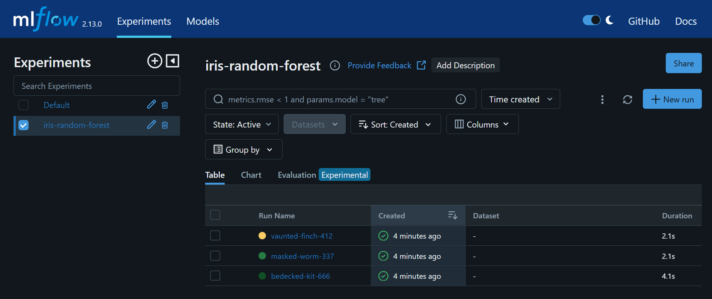
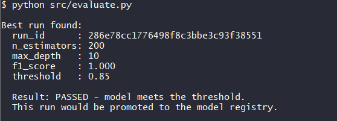
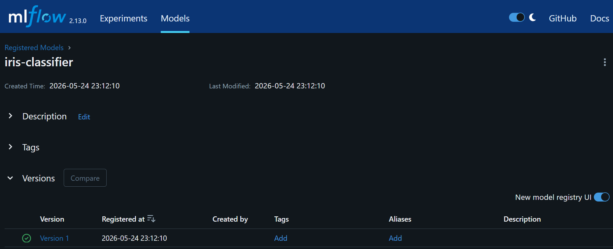
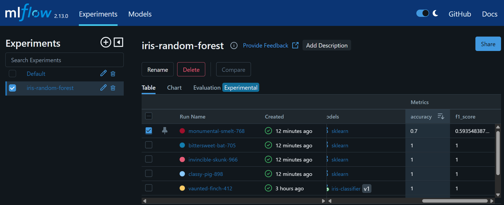
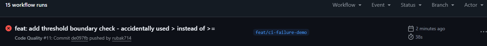
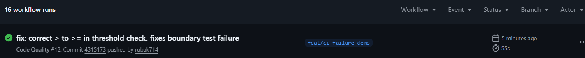

# 🤖 Azure MLOps and LLMOps Platform

---

> Most MLOps tutorials show you how to log a metric with MLflow and call it a pipeline.
> This one is different.
> Every design decision is documented. Every real error that came up is written down with the fix.
> The CI pipeline went red on the first run and the fix is in the commit history.
> Two of my four prompt versions fail their own promotion gate, and I left them in.
> One of my metrics ranked my worst prompt first, and that is written up rather than quietly reweighted.
> I tested a claim about prompts I had only read, found it was half wrong, and found a bug underneath it that was silently discarding half of every document.
> This is not a walkthrough of what MLflow can do.
> This is what actually happened when building **a real MLOps and LLMOps pipeline** from scratch as someone learning it for the first time.

---

I have been working with Terraform since last year through assigned company tasks covering GCP, Kubernetes, and Helm. More recently I built a full Azure data platform from scratch using Databricks, Key Vault, and ADLS Gen2. I also have an ML background from my thesis on missing data imputation using GANs, VAEs, DAEs, and statistical methods on DHS health survey data, plus supervised learning from university research and coursework.

**This repo is the next step:** taking what I know about infrastructure and ML and learning how to operationalize models and LLMs properly on Azure. The focus is MLflow experiment tracking, a threshold-based model promotion pipeline, GitHub Actions CI, and my first hands-on work with LLMOps patterns.

I am documenting what I learn as I go, including a dedicated [LLM_LEARNING.md](./LLM_LEARNING.md) for the LLM concepts that are new to me.

## 🧭 Start here: the interactive walkthrough

**[Gate by Gate — a step-by-step tour of all three pipelines](https://claude.ai/code/artifact/62adfa9e-0181-4e32-b918-8469538c3d07)**

A clickable system map with a 15-step walkthrough. Click any box to jump to what it does, or step through the whole thing with the arrow keys. It covers how the model pipeline, the prompt pipeline and the monitoring checks fit together, and why all three are built to the same shape.

If you have two minutes and want to know what this repo is, start there rather than here.

## 🔧 What this builds

Three pipelines that share the same shape on purpose - produce candidates, score them, gate the best one on a threshold, log everything to MLflow. That shape is the part that transfers.

**The model pipeline (MLOps)**

- A scikit-learn training pipeline with MLflow experiment tracking across four parameter combinations including one deliberately weak run
- A threshold-based model promotion gate - `evaluate.py` checks the best run against F1 ≥ 0.85 before `register_model.py` promotes it to the MLflow registry

**The prompt pipeline (LLMOps)**

- Four versioned prompts for a summarization task, progressing from zero-shot through explicit constraints and few-shot to a full output contract, with a `registry.json` recording what changed in each
- Four evaluation metrics written by hand - ROUGE-L, a grounding check for hallucination, length compliance, and format compliance - combined into one composite score
- A prompt promotion gate at composite ≥ 0.70, the LLMOps mirror of the F1 gate, with each prompt version logged as its own MLflow run and the prompt text kept as the run artifact
- A provider abstraction that defaults to a deterministic offline stub, so the whole evaluation runs in CI with no API key and no cost, and switches to Azure OpenAI when the credentials are present

**The drift pipeline**

- Per-feature drift detection using PSI and the two-sample Kolmogorov-Smirnov test, both implemented in numpy rather than imported
- A drift gate at PSI ≥ 0.25 using the conventional interpretation bands, across four scenarios: no drift, a recalibrated sensor, a class that stops appearing, and a noisier signal around an unchanged mean

**Serving**

- A FastAPI endpoint that loads whatever `register_model.py` promoted and answers prediction requests, with request validation, health reporting, and resolution of the registry's `latest` to a concrete version number

**Across all three**

- GitHub Actions CI that runs flake8 and pytest on every PR, the prompt evaluation as a gate when anything prompt-related changes, training and evaluation on every merge to main, and the drift check on a Monday morning cron
- 173 unit tests covering threshold logic, boundary cases, scoring maths, prompt rendering, provider selection, API validation, and the no-false-alarm case for drift
- A `Makefile` and a `pre-commit` config running the same flake8 flags CI uses, so the surprise in error 5 cannot happen twice
- 14 real errors documented in [docs/errors_and_fixes.md](./docs/errors_and_fixes.md) as they happened

Two results I would point at first. **ROUGE-L on its own ranked the worst of my four prompts highest** (error 11), which is why the composite exists. And testing a claim I had only read - that delimiters separate instructions from data - showed that my prompts **silently threw away half their input** when the text contained the wrong string, that adding `<text>` tags swapped which string triggers it rather than fixing it, and that the real fix is escaping, because this is SQL injection wearing a different hat (error 13).

## 🔧 Dataset

This project uses the **Iris dataset** from scikit-learn's built-in datasets (`sklearn.datasets.load_iris`).

**Why Iris:**
No external files, no downloads, no storage setup needed. It loads in one line and works offline. The dataset is a standard benchmark for classification pipelines, which makes it easy for me to focus on what this project is actually about - the MLflow tracking, evaluation logic, and CI pipeline rather than data wrangling.

**What it contains:**
150 samples of iris flowers across 3 species (setosa, versicolor, virginica). Each sample has 4 numeric features: sepal length, sepal width, petal length, and petal width. The task is to predict the species from the measurements.

**What I investigated:**

- Does changing the number of trees and tree depth improve the model's F1 score?
- Does the model reach the minimum F1 score (0.85) needed to be saved to the registry?
- What happens in the pipeline when a model is too weak to be promoted?
- Does the input distribution still look like the one the model was trained on?

### The LLM evaluation set

The prompt side needed its own data and I wrote it by hand - eight short texts in `llm_experiments/eval_dataset.json`, each with a reference summary.

Same reasoning as using Iris. No downloads, no external service, works offline, and small enough that I can read every generated summary by eye and check whether the metric agrees with me. The honest limitation is that eight examples I wrote myself is enough to build a harness and not enough to trust a 0.03 difference between two prompts.

## 🔧 How to run locally

    git clone https://github.com/rubak714/azure-mlops-llmops-platform.git
    cd azure-mlops-llmops-platform
    python -m pip install -r requirements.txt

**The model pipeline**

    # run training - logs 4 runs to MLflow
    python src/train.py

    # check which run passes the threshold
    python src/evaluate.py

    # register the best run in the MLflow model registry
    python src/register_model.py

**The prompt pipeline**

    # see the four prompt versions and what changed in each
    python -m src.prompt_registry

    # score every prompt version and apply the promotion gate
    python -m src.evaluate_prompts

    # check whether each prompt format keeps instructions and data apart
    python -m src.check_injection

**The drift check**

    # compare the reference window against four drift scenarios
    python -m src.detect_drift

**Serving the promoted model**

    # needs train.py, evaluate.py and register_model.py to have run first
    uvicorn src.serve:app --reload

Then open `http://127.0.0.1:8000/docs` for the generated API docs, or:

    curl -X POST http://127.0.0.1:8000/predict \
      -H "Content-Type: application/json" \
      -d '{"instances": [[5.1, 3.5, 1.4, 0.2], [6.7, 3.0, 5.2, 2.3]]}'

    # {"predictions":[{"class_id":0,"class_name":"setosa"},
    #                 {"class_id":2,"class_name":"virginica"}],
    #  "model_name":"iris-classifier","model_stage":"latest"}

If nothing has been registered yet, `/predict` returns a 503 naming the commands that fix it rather than a 500, because an empty registry is a deployment state and not a bug.

**Or just use the Makefile**

Every command above has a shortcut, which exists because errors 1 and 10 were both invocation mistakes rather than code mistakes:

    make help         # list everything
    make ci           # lint and test, what the PR pipeline runs
    make prompt-eval  # score the prompt versions
    make drift        # run the drift scenarios
    make serve        # serve the promoted model

**Everything else**

    # 173 tests, none of which make a network call
    python -m pytest tests/ -v

    # open the MLflow UI to see all runs
    mlflow ui

Then open `http://127.0.0.1:5000` in your browser. There are three experiments in the left sidebar - `iris-random-forest` for the training runs, `prompt-summarization` for the prompt versions, and `iris-drift-detection` for the drift scenarios.

Note that the newer scripts need `python -m src.evaluate_prompts` rather than `python src/evaluate_prompts.py`. They import from the `src` package, and running a file directly puts that file's own folder on the path instead of the repo root. This is error 10 in the errors doc.

**No API key is needed for any of the above.** The prompt evaluation defaults to an offline provider. To run it against a real Azure OpenAI deployment instead, set these and it switches by itself:

    $env:AZURE_OPENAI_ENDPOINT   = "https://<resource>.openai.azure.com"
    $env:AZURE_OPENAI_API_KEY    = "<key>"
    $env:AZURE_OPENAI_DEPLOYMENT = "<deployment name>"

## 🔧 Project structure

    azure-mlops-llmops-platform/
    ├── .github/
    │   └── workflows/
    │       ├── code-quality.yml       # flake8 and pytest on every PR
    │       ├── train-evaluate.yml     # training and evaluation on merge to main
    │       ├── prompt-eval.yml        # prompt scoring as a gate on prompt changes
    │       └── drift-check.yml        # drift detection on a Monday cron
    ├── src/
    │   ├── train.py                   # trains the model and logs runs to MLflow
    │   ├── evaluate.py                # checks the best run against the threshold
    │   ├── register_model.py          # registers the model if it passes
    │   ├── llm_client.py              # offline stub and Azure OpenAI provider
    │   ├── prompt_registry.py         # loads versioned prompts and the eval set
    │   ├── prompt_metrics.py          # ROUGE-L, grounding, and compliance scoring
    │   ├── evaluate_prompts.py        # scores every prompt version, applies the gate
    │   ├── check_injection.py         # prompt boundary integrity against hostile input
    │   ├── detect_drift.py            # PSI and KS drift detection per feature
    │   └── serve.py                   # FastAPI endpoint for the promoted model
    ├── tests/
    │   ├── test_evaluate.py           # threshold logic and boundary cases
    │   ├── test_data_loading.py       # data split and shape checks
    │   ├── test_prompt_metrics.py     # scoring maths and the prompt gate
    │   ├── test_prompt_registry.py    # prompt loading and rendering
    │   ├── test_llm_client.py         # provider selection and the stub
    │   ├── test_check_injection.py    # prompt boundary findings, pinned
    │   ├── test_detect_drift.py       # PSI, KS, and the no-false-alarm case
    │   └── test_serve.py              # API contract, validation, caching
    ├── llm_experiments/
    │   ├── registry.json              # the prompt registry - versions and changes
    │   ├── prompt_v1.txt              # zero-shot, minimal
    │   ├── prompt_v2.txt              # zero-shot with explicit constraints
    │   ├── prompt_v3.txt              # few-shot with delimiters
    │   ├── prompt_v4.txt              # role framing and an output contract
    │   ├── eval_dataset.json          # 8 texts with hand-written reference summaries
    │   ├── injection_tests.json       # hostile inputs for the boundary check
    │   └── notes.md                   # what changed between versions and the scores
    ├── notebooks/
    │   └── ml_exploration.ipynb       # dataset exploration before writing train.py
    ├── docs/
    │   ├── architecture.md            # how the pieces connect and why
    │   ├── prompt_engineering.md      # the prompting techniques and what they measured
    │   └── errors_and_fixes.md        # 12 real errors hit during the build
    ├── screenshots/                   # MLflow UI, CI runs, evaluate output
    ├── LLM_LEARNING.md                # running notes on LLM concepts new to me
    ├── Makefile                       # shortcuts for every command above
    ├── .pre-commit-config.yaml        # the same flake8 flags CI uses, before pushing
    └── requirements.txt

## 🔧 How the pipeline works

    src/train.py
        trains RandomForestClassifier across 4 parameter combinations
        logs parameters, accuracy, F1 score, and model artifact to MLflow
            |
            v
    src/evaluate.py
        finds the best run by F1 score in the iris-random-forest experiment
        checks whether it meets the promotion threshold of 0.85
        prints PASSED or FAILED with the run details
            |
            v
    src/register_model.py
        runs the same threshold check
        if F1 >= 0.85 → registers the model in the MLflow registry
        if F1 < 0.85  → exits without registering anything
            |
            v
    .github/workflows/train-evaluate.yml
        runs train.py and evaluate.py automatically on every merge to main
        so any change that affects model performance is visible immediately

The deliberately weak run (n_estimators=2, max_depth=1) scores around F1=0.72 and demonstrates the gate blocking a bad model. The three stronger runs all score F1=1.0 on this dataset and pass.

## 🔧 How the prompt pipeline works

    llm_experiments/registry.json
        four prompt versions, each with its technique and what changed
            |
            v
    src/prompt_registry.py
        loads a version and substitutes the input text
            |
            v
    src/llm_client.py
        sends the prompt to the active provider
        offline stub by default, Azure OpenAI when configured
            |
            v
    src/prompt_metrics.py
        ROUGE-L, grounding, length compliance, format compliance
            |
            v
    src/evaluate_prompts.py
        runs every version over all 8 examples
        logs each version as its own MLflow run
        best version by composite score, gated at 0.70

A prompt is a text file, so it felt like configuration rather than part of the model. The thing that took me longest to accept about LLMOps is that editing a prompt changes the system's behaviour exactly the way retraining does - which means an untracked prompt change is the same class of problem that MLflow exists to solve. So the prompt gets a version, a recorded score, and a gate.

**The results, averaged over all eight evaluation examples:**

| Version | Technique | ROUGE-L | Grounding | Length | Format | Composite |
|---|---|---|---|---|---|---|
| v1 | zero-shot, minimal | **0.582** | 0.721 | 0.00 | 0.00 | 0.449 |
| v2 | explicit constraints | 0.498 | 0.834 | 1.00 | 0.00 | 0.650 |
| v3 | few-shot + delimiters | 0.563 | 1.000 | 1.00 | 1.00 | **0.825** |
| v4 | role + output contract | 0.563 | 1.000 | 1.00 | 1.00 | **0.825** |

Two things in that table I did not expect.

**ROUGE-L alone ranks v1 first.** At 0.582 it beats every other version, and v1 is unambiguously the worst prompt - the only one that invents a closing sentence and the only one that ignores the length limit. It writes four sentences where the others write two, and more text means more overlap with the reference, so ROUGE rewarded it for rambling. I set the four weights before running the comparison. This is the strongest argument I have for why the composite exists.

**v3 and v4 tie exactly,** even though v4 is the better prompt. That is the offline stub's ceiling rather than a real finding about the prompts, and it is written up as error 12 rather than hidden.

The techniques themselves, and what each one actually does, are in [docs/prompt_engineering.md](./docs/prompt_engineering.md).

## 🔧 How the drift check works

    src/detect_drift.py
        reference window  = the distribution the model was trained on
        current window    = what is arriving now
            |
            v
        per feature: PSI and the two-sample KS statistic
            |
            v
        gate at PSI >= 0.25, using the conventional bands
            |
            v
    .github/workflows/drift-check.yml  runs it on a Monday cron

`evaluate.py` asks whether the model is good on the data it was trained on. This asks whether that data still resembles the data arriving now - a model can hold a perfect F1 on its own test split for a year while the live inputs move away underneath it. Until this existed, nothing in the project would have noticed.

| Scenario | What it simulates | Features flagged |
|---|---|---|
| `no-drift` | resample, same distribution | 0 of 4 |
| `measurement-shift` | one recalibrated sensor | 1 of 4 - petal length, PSI 4.17 |
| `population-shift` | one class stops appearing | 4 of 4 |
| `noise-increase` | wider spread, unchanged mean | 3 of 4 |

`measurement-shift` is the one that shows why reporting per feature matters: petal length scores 4.17 and the other three score exactly 0.00. "The data drifted" is not actionable. "Petal length drifted and nothing else did" points straight at one instrument.

`no-drift` is the test I care about most. A monitor that fires on data which has not changed is worse than no monitor, because people learn to ignore it.

See [docs/architecture.md](./docs/architecture.md) for the full design decisions behind each component.

## 📸 Screenshots and diagrams

### Pipeline diagram

This one covers the model pipeline only, which is all there was when I drew it. The interactive walkthrough linked at the top of this README covers all three.

### MLflow experiment runs

### Evaluate output - threshold check

### Model registered in MLflow registry

### MLflow with weak model run visible

### CI pipeline - red run caught a broken test

### CI pipeline - green after fix

## 🔧 Docs and learning notes

| File | What it covers |
|---|---|
| [docs/architecture.md](./docs/architecture.md) | How the three pipelines connect, design decisions, and what is missing vs a production setup |
| [docs/prompt_engineering.md](./docs/prompt_engineering.md) | The prompting techniques, what each one measured, and how I scored text output |
| [docs/errors_and_fixes.md](./docs/errors_and_fixes.md) | 14 real errors hit during the build with root cause and fix for each |
| [LLM_LEARNING.md](./LLM_LEARNING.md) | Running notes on LLM concepts - tokens, RAG, hallucination, LLMOps, Azure AI Foundry |
| [llm_experiments/notes.md](./llm_experiments/notes.md) | What changed between each prompt version and what the scores said |

## 🔧 One thing to be clear about

The prompt evaluation runs against an **offline simulator by default, not a language model.** It is a deterministic extractive summarizer that reads the constraints out of a prompt, obeys them, and deliberately misbehaves - inventing a closing sentence, opening with a preamble - when the prompt does not forbid it.

I built it that way because the alternatives were worse. Requiring a live Azure OpenAI deployment would mean nobody can run this repo without a subscription and a bill, and CI could not run the evaluation at all. Skipping prompt evaluation would leave the LLMOps half of this project as four text files and no measurement.

What it proves: the pipeline works end to end, and the metrics catch the failures they were written to catch. What it does not prove: anything about how a real model would score. The numbers measure how precisely each prompt states its requirements, which is a real property of a prompt and is not the same thing as output quality.

The Azure OpenAI adapter is written and its configuration and failure paths are tested, but it has not been run against a provisioned deployment. Same cost reason the Databricks workspace from my previous repo was destroyed after verifying it worked.

## 🔧 Note on tooling

The prompt evaluation pipeline, the drift detection, and the documentation around them were built with Claude Code as an assistant. Every number quoted in this repo is real output from the code in it - the prompt scores come from `python -m src.evaluate_prompts` and the drift figures from `python -m src.detect_drift`, and the limitations recorded in `errors_and_fixes.md` are the ones I actually ran into rather than illustrative examples.

## 🔧 Related repo

[azure-data-platform-terraform](https://github.com/rubak714/azure-data-platform-terraform) - the infrastructure layer this builds on. Covers Terraform modules for Databricks, ADLS Gen2, Key Vault, and VNet on Azure deployed to Germany West Central with a full GitHub Actions CI/CD pipeline.

## 🔧 Status

Complete. Model training with threshold-gated registry promotion, prompt versioning with a scored promotion gate, prompt boundary checks, scheduled drift detection, and an HTTP endpoint serving the promoted model. 173 tests, flake8 clean, and 14 errors documented as they happened.

Everything listed as a next step in earlier versions of this README - LLM API integration, drift detection, and a serving layer - is now done.

What I would build next, in order:

1. **Deploy the serving layer.** It runs locally under uvicorn. No container image, no Azure Container Apps or AKS deployment, no authentication, no rate limiting. The API contract is real; the hosting is not.
2. **A live Azure OpenAI deployment**, and then re-running the prompt comparison against a real model to find out how much the offline numbers were worth. It would also close the one injection gap escaping cannot: a model choosing to follow an instruction written in plain English, where there is no delimiter to escape.
3. **Wiring drift to retraining.** Easy to do and I am not convinced it is right - retraining automatically on drifted data can make a model worse, and the alert is really asking a human to look at why the inputs moved.